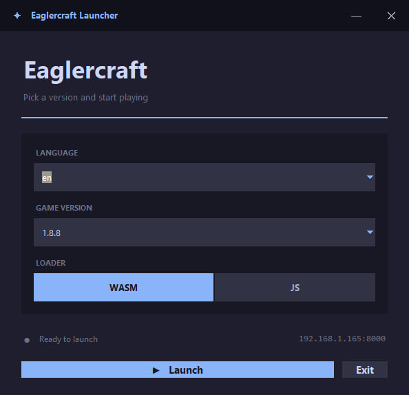
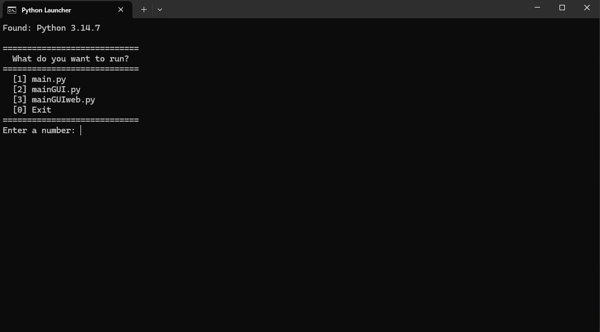

[English](README.md) | [Русский](README-ru.md)

<a href="https://www.star-history.com/?repos=sashkann-lang%2Feaglercraft-launcher&type=date&legend=top-left">
 <picture>
   <source media="(prefers-color-scheme: dark)" srcset="https://api.star-history.com/chart?repos=sashkann-lang/eaglercraft-launcher&type=date&theme=dark&legend=top-left" />
   <source media="(prefers-color-scheme: light)" srcset="https://api.star-history.com/chart?repos=sashkann-lang/eaglercraft-launcher&type=date&legend=top-left" />
   
 </picture>
</a>

🎮 Eaglercraft Launcher

A simple local launcher for Eaglercraft — run any version right in your browser or in a native window.

⚠️ DISCLAIMER

THIS IS NOT AN OFFICIAL MINECRAFT PRODUCT.
NOT APPROVED BY OR ASSOCIATED WITH MOJANG OR MICROSOFT.

This project is not affiliated with Mojang, Microsoft, or the original Eaglercraft by LAX1DUDE. It does not distribute any Minecraft game files or assets. It only serves locally-stored HTML files through a local HTTP server.

For personal, educational, and non-commercial use only.
No ads. No monetization.

────────────────────────────────────────

📖 ABOUT

Eaglercraft Launcher runs Eaglercraft versions locally with one click. It starts a local HTTP server and serves the game.

Three interfaces:
- CLI (main.py) — simple text menu
- GUI (mainGUI.py) — dark-themed window, opens game in browser
- GUI Native (mainGUIweb.py) — same window, opens game in a separate native window via pywebview

All support English and Russian.

────────────────────────────────────────

✨ FEATURES

- Versions: 1.3 beta, 1.5.2, 1.7.3 beta, Indev, Scratch, 1.8.8, 1.12.2, 26.2
- WASM / JS loaders for 1.8.8 and 1.12.2
- English & Russian UI
- Auto-opens browser (CLI / GUI) or native window (GUI Native)
- No dependencies for CLI and GUI — pure Python standard library
- pywebview required for GUI Native (installed via install.cmd)

────────────────────────────────────────

📋 REQUIREMENTS

- Python 3.10 or newer
- Windows 10 / 11
- Any modern browser
- ~250 MB disk space for game files

For GUI Native (mainGUIweb.py):
- pywebview (install via install.cmd)
- Microsoft Edge WebView2 (usually pre-installed on Windows 10/11)

────────────────────────────────────────

🚀 QUICK START

**Windows:**
1. Extract the archive.
2. Run install.cmd (installs pywebview for GUI Native).
3. Run start.cmd and choose which launcher to start.
4. Launch and play.

**MLA (Mac, Linux, Android):**
1. Extract the archive.
2. Open Terminal.
3. Make scripts executable:
   chmod +x start.sh install.sh
4. Install dependencies (for GUI Native):
   ./install.sh
5. Run the launcher:
   ./start.sh
6. Choose which launcher to start and play.

*(For Android, use Termux. Install Python first: `pkg install python`)*

────────────────────────────────────────

🎮 USAGE

**Windows:**
Option 1 — double-click start.cmd, pick 1, 2 or 3.
Option 2 — run manually:
    python main.py          (CLI)
    python mainGUI.py       (GUI — opens in browser)
    python mainGUIweb.py    (GUI Native — opens in a separate window)

**MLA (Mac, Linux, Android):**
Option 1 — run in terminal:
    ./start.sh
Option 2 — run manually:
    python3 main.py
    python3 mainGUI.py
    python3 mainGUIweb.py

Then choose language, version, loader (if needed) — the game opens automatically.
To stop: close window or press Ctrl+C (MLA) / Enter (Windows).

────────────────────────────────────────

📁 STRUCTURE

    main.py            # CLI launcher
    mainGUI.py         # GUI launcher (Tkinter) — browser
    mainGUIweb.py      # GUI launcher (Tkinter + pywebview) — native window
    start.cmd          # Windows menu
    install.cmd        # Installs pywebview (Windows)
    start.sh           # MLA menu
    install.sh         # Installs pywebview (MLA)
    versions/          # game files (NOT included)

────────────────────────────────────────

⚖️ LICENSE

MIT — applies only to launcher code.

NOT covered by MIT:
- Minecraft (Mojang / Microsoft)
- Eaglercraft (LAX1DUDE)
- Game files in versions/

────────────────────────────────────────

🙏 CREDITS

- Eaglercraft by LAX1DUDE
- Minecraft by Mojang / Microsoft
- Launcher code by me (GUI and GUI Native with AI assistance)
- Design inspired by Catppuccin

────────────────────────────────────────

Made with ❤️ and Python
